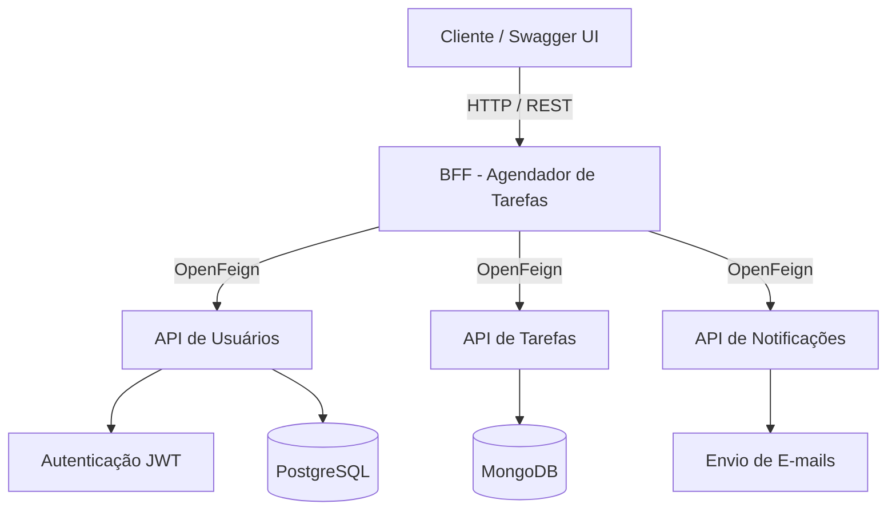

# BFF — Agendador de Tarefas

Backend For Frontend (BFF) desenvolvido em **Java e Spring Boot**, responsável pela integração entre os microsserviços de usuários, tarefas e notificações do Sistema de Agendamento de Tarefas.

O projeto utiliza uma arquitetura baseada em **microsserviços**, com responsabilidades separadas e comunicação entre APIs utilizando **Spring Cloud OpenFeign**.

---

## Arquitetura do Sistema

O sistema é composto por quatro aplicações independentes, sendo três microsserviços e um BFF responsável pela integração.



### Repositórios do Sistema

| Microsserviço | Responsabilidade | Repositório |
|---|---|---|
| BFF | Integração e centralização das operações | [bff-agendador-tarefas](https://github.com/arthurcoelho04/bff-agendador-tarefas) |
| Usuários | Gerenciamento de usuários e autenticação JWT | [usuario](https://github.com/arthurcoelho04/usuario) |
| Tarefas | Cadastro, consulta, atualização e exclusão de tarefas | [agendador-tarefas](https://github.com/arthurcoelho04/agendador-tarefas) |
| Notificações | Envio de notificações por e-mail | [notificacao](https://github.com/arthurcoelho04/notificacao) |

Cada microsserviço possui seu próprio repositório e README com informações específicas sobre suas funcionalidades, tecnologias e execução.

---

## Funcionalidades

- **Gerenciamento de Usuários:** Centralização das operações de cadastro, consulta e autenticação.
- **Gerenciamento de Tarefas:** Cadastro, consulta, atualização e exclusão de tarefas.
- **Integração entre Microsserviços:** Comunicação entre APIs utilizando OpenFeign.
- **Agendamento Automático:** Verificação periódica das tarefas utilizando Cron.
- **Envio de Notificações:** Integração com o serviço responsável pelo envio de e-mails.
- **Autenticação JWT:** Encaminhamento de tokens para operações protegidas.
- **Tratamento de Exceções:** Gerenciamento centralizado de erros.

---

## Tecnologias Utilizadas

- **Java 21:** Linguagem de programação.
- **Spring Boot:** Desenvolvimento da API REST.
- **Spring Cloud OpenFeign:** Comunicação entre microsserviços.
- **Spring Scheduling (Cron):** Execução automática de tarefas.
- **Springdoc OpenAPI / Swagger:** Documentação dos endpoints.
- **Docker:** Conteinerização dos serviços.
- **Gradle:** Gerenciamento de dependências.

### Tecnologias dos Microsserviços

| Tecnologia | Aplicação |
|---|---|
| Spring Security | Segurança e autenticação |
| JWT | Autenticação baseada em tokens |
| PostgreSQL | Persistência de dados dos usuários |
| MongoDB | Persistência de dados das tarefas |
| Spring Mail | Envio de notificações |
| Thymeleaf | Templates de e-mail |

---

## Comunicação entre Microsserviços

O BFF atua como ponto central de acesso às funcionalidades do sistema.

A comunicação com os demais serviços é realizada por meio do **Spring Cloud OpenFeign**, permitindo a integração entre as APIs através de requisições HTTP.

### Fluxo de Funcionamento

1. O cliente realiza uma requisição ao BFF.
2. O BFF recebe a solicitação e identifica o serviço responsável.
3. O OpenFeign realiza a comunicação com o microsserviço correspondente.
4. O microsserviço executa a operação solicitada.
5. O resultado é retornado ao BFF.
6. O BFF encaminha a resposta ao cliente.

### Agendamento e Notificações

O sistema também possui rotinas automáticas utilizando **Spring Scheduling (Cron)** para verificar periodicamente tarefas agendadas.

Quando necessário, o BFF integra-se ao microsserviço de notificações, responsável pelo envio de e-mails.

---

## Como Executar

### Pré-requisitos

- Java 21
- Docker
- Git
- Gradle (ou Gradle Wrapper)

### 1. Clone os repositórios

**BFF:**

```bash
git clone https://github.com/arthurcoelho04/bff-agendador-tarefas.git
```

**Microsserviço de Usuários:**

```bash
git clone https://github.com/arthurcoelho04/usuario.git
```

**Microsserviço de Tarefas:**

```bash
git clone https://github.com/arthurcoelho04/agendador-tarefas.git
```

**Microsserviço de Notificações:**

```bash
git clone https://github.com/arthurcoelho04/notificacao.git
```

### 2. Configure os microsserviços

Configure os endereços de comunicação entre as APIs e as conexões necessárias com os bancos de dados.

Consulte o README individual de cada microsserviço para verificar suas configurações específicas.

### 3. Inicie os serviços

Inicie os microsserviços de usuários, tarefas e notificações.

### 4. Execute o BFF

Acesse o diretório:

```bash
cd bff-agendador-tarefas
```

Execute:

```bash
./gradlew bootRun
```

No Windows:

```bash
gradlew.bat bootRun
```

### 5. Acesse a aplicação

Após iniciar os serviços, o BFF estará disponível em:

```text
http://localhost:8083
```

---

## Documentação da API

O projeto utiliza **Swagger/OpenAPI** para documentação e testes dos endpoints.

Após iniciar a aplicação, acesse:

**Swagger UI:**

http://localhost:8083/swagger-ui/index.html

Por meio do Swagger é possível consultar os endpoints disponíveis e realizar testes das operações.

---

## Projeto Principal

Este repositório representa o **ponto central de integração do Sistema de Agendamento de Tarefas**.

O código-fonte dos demais microsserviços está disponível nos respectivos repositórios:

- [API de Usuários](https://github.com/arthurcoelho04/usuario)
- [API de Tarefas](https://github.com/arthurcoelho04/agendador-tarefas)
- [API de Notificações](https://github.com/arthurcoelho04/notificacao)

---

## Autor

**Arthur Coelho**

[GitHub](https://github.com/arthurcoelho04)
